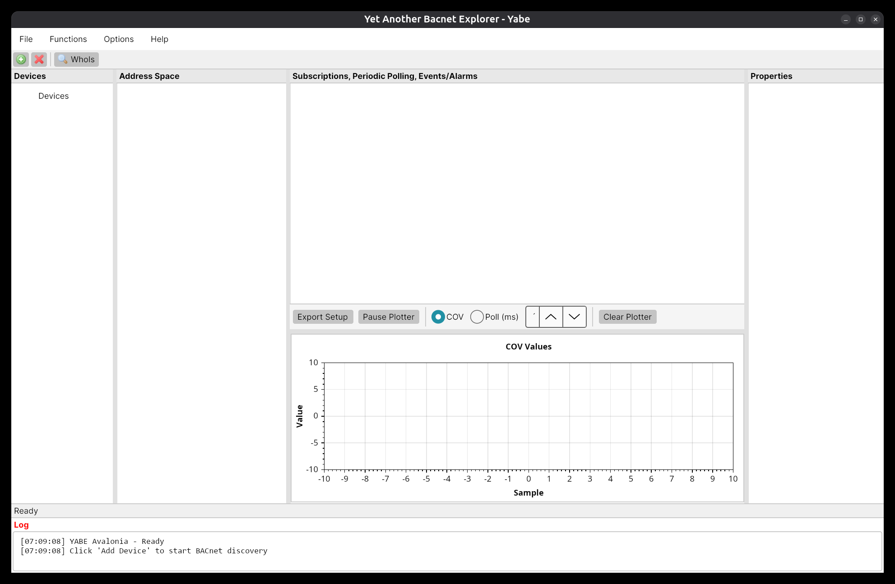

# YabeAvalonia

Native Linux port of [YABE (Yet Another BACnet Explorer)](https://sourceforge.net/projects/yetanotherbacnetexplorer/) using [Avalonia UI](https://avaloniaui.net/).

YABE is a widely used open-source BACnet device browser and diagnostic tool. The original runs on Windows (WinForms). This port replaces the WinForms UI with Avalonia UI 11, enabling native execution on Linux (x64 and ARM64) without Mono.



## Features

- BACnet device discovery (BACnet/IP, BACnet/IPv6, MSTP, PTP, Ethernet)
- Address space browsing and property reading/writing
- COV subscriptions and periodic polling with live chart
- Alarm summary and acknowledgement
- Trend log display with CSV export
- Schedule, calendar, and notification class editors
- File transfer (upload/download)
- Foreign device registration
- Communication control and object creation

## Requirements

- .NET 10 Runtime (or use the self-contained releases)
- Linux x64 or ARM64

## Quick start

### From release (recommended)

Download the appropriate archive from [Releases](../../releases), extract and run:

```bash
chmod +x YabeAvalonia
./YabeAvalonia
```

### From source

```bash
git clone https://github.com/vpinto-aura/yabe-avalonia.git
cd yabe-avalonia
dotnet run --project Yabe.App
```

## Building releases

```bash
# Linux x64
dotnet publish Yabe.App -c Release -r linux-x64 --self-contained -o publish/linux-x64

# Linux ARM64 (Raspberry Pi, etc.)
dotnet publish Yabe.App -c Release -r linux-arm64 --self-contained -o publish/linux-arm64
```

## Project structure

```
YabeAvalonia/
  Yabe.Core/          BACnet protocol stack (System.IO.BACnet)
  Yabe.App/           Avalonia UI application
    MainWindow.axaml  Main 4-column layout
    Assets/           Icons and resources
    *Dialog.axaml     Popup dialogs
```

## License

MIT License - see [LICENSE](LICENSE).

Original YABE by Morten Kvistgaard and Frederic Chaxel.
Avalonia port by Vicente Pinto / Aura Monitorizacion y Control.

## Acknowledgements

This project would not exist without the extraordinary work of the original YABE developers. A huge and heartfelt thank you to:

- **Morten Kvistgaard** - creator of YABE and the System.IO.BACnet stack. His decision to release YABE under the MIT license has enabled the entire BACnet open-source community to grow, learn, and build upon his work. YABE remains one of the most reliable and comprehensive BACnet diagnostic tools available, and the quality of the BACnet protocol implementation is remarkable.

- **Frederic Chaxel (F. Chaxel)** - who took over maintenance and significantly expanded YABE's capabilities over many years, adding support for new BACnet services, improving the user interface, and keeping the project alive and relevant. His sustained dedication to the project has been invaluable to thousands of building automation engineers worldwide.

- All other contributors to the [YABE project](https://sourceforge.net/projects/yetanotherbacnetexplorer/) who have submitted bug reports, patches, plugins, and documentation over the years.

The BACnet community owes a great debt to these developers. Their open-source work has democratized access to BACnet diagnostics and made it possible for engineers everywhere to inspect, debug, and understand BACnet networks without expensive proprietary tools. This Avalonia port is simply a new front-end for their excellent protocol stack, bringing it natively to Linux.

### Libraries

- [Avalonia UI](https://avaloniaui.net/) - cross-platform .NET UI framework
- [ScottPlot](https://scottplot.net/) - plotting library
- [SharpPcap](https://github.com/dotpcap/sharppcap) - packet capture for BACnet/Ethernet
